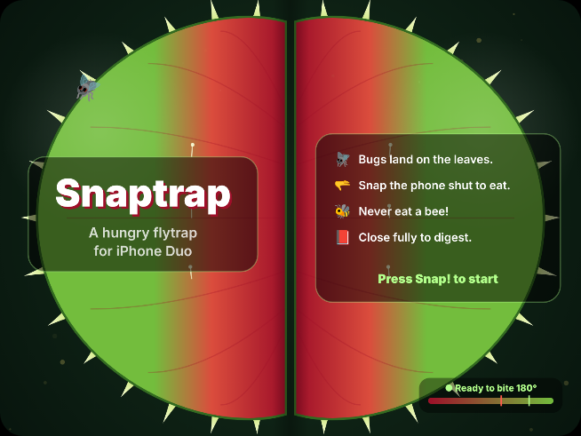

# Snaptrap 🪴

**A hungry Venus flytrap for iPhone Duo. The phone's two halves are the trap's jaws.**

Bugs buzz over the open leaves and land on them. Fold the phone shut fast to snap. Every bug sitting on a leaf gets eaten, and catching several in one bite multiplies the score. Never eat a bee. Close all the way and the trap moves to the cover display to chew on what it caught. Unfold it and the leaves bloom back open.

<p align="center"></p>

## The fold animations

Folding is what makes the game work, so each stage of the fold has its own animation:

| Hinge | What happens |
| --- | --- |
| **Opening** (cover → inner display) | **Bloom.** The leaves unfurl out of the fold and overshoot a little, like a leaf springing open. The teeth pop out in a ripple, middle first. Pollen puffs out of the crease, and the trap yawns. |
| **Folding** (180° → 105°) | The teeth bristle, grow longer and curl inward like closing fingers. The red throat spreads outward and the crease darkens. Bugs sitting on a leaf get a ❗️. All of this follows the live hinge angle. |
| **Snap** (open past 145°, then fold past 105°) | Two rows of glowing teeth slam in from the outer edges and lock together in the fold. The screen flashes and shakes, and you feel a heavy haptic tap. Caught bugs spin into the crease and crumbs spray out. |
| **Closing** (inner → cover display) | The two leaves fly in from the sides, swing shut like jaws and squash on impact (a damped spring). Then the pod chews (`^ ^`, "burp!") or dozes off (`‿ ‿`, z's) on a little terracotta pot. |

## How it uses iPhone Duo

- **`onHingeChange`** drives the game. `SnapDetector` turns the angle stream into bites, and `HingeReading.closure` feeds the folding visuals. `DeviceHinge.Status.closed` switches to the cover-display view.
- **Reserved regions:** `GeometryProxy.reservedRegions(kind: .division, options: .includeInactive)` gives the fold's frame. The leaves meet there, caught bugs get pulled into it, and the HUD is split into two pages so no controls sit on the crease. A sideways fold (the phone held like a laptop) rotates the whole trap.
- **Two displays, two moods.** The inner display is for hunting. The cover display is a calm tamagotchi-style screen showing what the trap is digesting, your stats, and its growth stage (🌱 Sprout → 👑 Swamp Legend, saved between launches).
- **No hinge? No problem.** On other iPhones and in Xcode Previews, a virtual hinge panel (a slider plus **Snap!** and **Close** buttons) feeds the same pipeline.

## Research: what's out there

Before building this I looked at what people have already made for iPhone Duo (announced September 9, 2026; on sale since October 23). Most of the standout apps use the hinge as an *instrument* or *controller*:

- **Duo-Man** (Vidit Bhargava): a virtual Walkman. Open the phone to load a cassette, close it to play. It came second at the Bitrig hackathon.
- **Crate**: an MPC-style beat app whose effects follow the hinge angle. It won first place at that hackathon.
- **Accorduon**, **SandValley**, **Duogami**, **ClawKit**, **DuoBird**, **DuoCut** (Artem Novichkov): an accordion whose bellows are the hinge, sand that slides into the fold, origami, a claw machine split across the fold, Flappy Bird with hinge flaps, and the fold as a blade.
- **Foldtales** (the fold angle makes objects look 3D) and **duo-lingo** (unfolding reveals flashcard answers).
- Apple's guidance is to use hinge data for effects and interactions driven by the fold itself, not for ordinary layout, and to keep controls off the fold.

Snaptrap goes somewhere none of these do: the phone *is* a creature's mouth. Both screen halves are the jaws, the crease is the throat, and closing the phone means it's eating. That's also why it gets two very different screens: hunting when open, digesting when closed.

## Project layout

```
Snaptrap/
  Snaptrap.xcodeproj
  Snaptrap/
    App/      SnaptrapApp, RootView (hinge → game wiring, display switching, game loop, haptics)
    Hinge/    HingeReading, SnapDetector, VirtualHinge
    Game/     GameModel, Bug, TrapLayout (trap space + fold geometry), Stage
    Views/    TrapView, TrapRenderer (Canvas), TrapHUD, CoverView + PodRenderer, VirtualHingePanel, Theme
web-preview/  The same renderer ported to a <canvas>, to try the animations in a browser
ci/           ExportOptions.plist and the Xcode selector used by .github/workflows/testflight.yml
```

## Requirements

- Xcode 27.1+, the iOS 27.1 SDK, Swift 6
- The iPhone Duo simulator or an iPhone Duo. On any other iPhone it falls back to the virtual hinge.

**On your iPhone Duo via TestFlight (no Mac needed):** GitHub Actions compiles every push, and the **Build & TestFlight** workflow archives, signs and uploads a build to TestFlight. One-time setup is in [TESTFLIGHT.md](TESTFLIGHT.md).

**With a Mac:** open `Snaptrap/Snaptrap.xcodeproj`, pick the iPhone Duo simulator, and run. Use the simulator's posture controls to fold the device.

## Web preview

`web-preview/index.html` is a direct port of the renderer and game rules to a browser canvas. Open it locally, drag the hinge slider or press <kbd>Space</kbd> to snap, and use **Close** / **Unfold** to see the cover-display transition.
